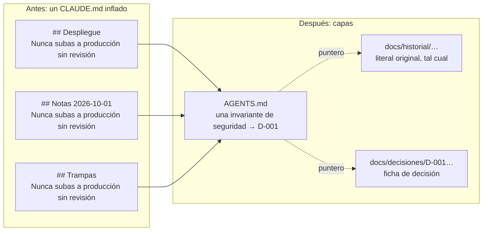

# declutter

[English](README.md)

**Ordena el contexto de tu agente de IA (CLAUDE.md / AGENTS.md) sin perder una sola regla, y demuéstralo.**

*Declutter your AI agent's context (CLAUDE.md / AGENTS.md) without losing a single rule — and prove it.*


`declutter` es una herramienta de línea de comandos en Python (`declutter`), un plugin de Claude
Code y un método documentado. Mide el contexto que cargan tus agentes al empezar, reorganiza un
`CLAUDE.md` / `AGENTS.md` inflado en capas con una prueba byte a byte de que no se perdió nada, y
evita que vuelva a crecer. El motor usa solo la biblioteca estándar, lee archivos, no usa la red y
no llama a ninguna IA.

## Antes y después

Es común que la misma regla de seguridad termine pegada en varias secciones de `CLAUDE.md`.
`declutter reorg` mueve cada línea, tal cual, a una sola capa; después el destilado reemplaza las
copias repetidas por una invariante corta que apunta al literal original, guardado en el historial.



La misma idea en texto plano (ejemplo sintético):

```text
ANTES                                        DESPUÉS
CLAUDE.md                                    AGENTS.md
├─ ## Despliegue                             └─ Invariantes de seguridad (destiladas)
│   - Nunca subas a producción sin revisión      - Nunca subas a producción sin revisión → D-001
├─ ## Notas 2026-10-01                       docs/historial/2026-10.md
│   - Nunca subas a producción sin revisión      cada línea original, tal cual, con su ancla
└─ ## Trampas                                docs/decisiones/D-001-….md
    - Nunca subas a producción sin revisión      qué, por qué, alternativa descartada, trampa
```

## Instalación

Motor (Python 3.11 o superior), directo desde el repositorio con pipx:

```bash
pipx install git+https://github.com/nodo-salud-lab/declutter
declutter --version
```

La distribución en PyPI se llamará `declutter-context` (el nombre `declutter` está ocupado);
todavía no está publicada, así que se instala desde el repositorio. El paquete importable es
`declutter_context` y el comando es `declutter`.

Plugin de Claude Code (opcional; llama al comando `declutter`, así que instala primero el motor).
El repositorio funciona también como marketplace llamado `declutter`:

```text
/plugin marketplace add nodo-salud-lab/declutter
/plugin install declutter@declutter
```

Plataformas: macOS y Linux. Windows no está probado: el hook del plugin usa sintaxis de shell
POSIX (`2>/dev/null || true`), así que necesita Git Bash.

## Inicio rápido (3 comandos)

Dentro de un repositorio git con un `CLAUDE.md`:

```bash
declutter measure              # 1. semáforo: qué pesa y por qué
declutter reorg plan           # 2. plan sin pérdida + proyección; imprime el id de la corrida
declutter reorg apply <id>     # 3. escribe en una rama nueva declutter/reorg-<id>, probado byte a byte
```

Si el plan lista confirmaciones pendientes (unidades con una regla imperativa que saldrían de la
capa 1), registra tu decisión para cada una con `declutter reorg set` antes de aplicar. En Claude
Code, `/declutter:declutter` te guía por todo el proceso: mide, ofrece `/declutter:declutter-reorg`
si todavía no hay una reorganización o `/declutter:declutter-auto` si ya la hay, y termina mostrando
lo que se ahorró solo con las cifras que imprimen las herramientas.

## Comparación

Hay varias herramientas buenas que trabajan sobre el contexto de los agentes y resuelven problemas
distintos. La tabla describe categorías en términos generales; revisa cada proyecto para conocer
sus funciones actuales.

| Tipo de herramienta | Ejemplos | Para qué sirve | Qué hace declutter en cambio |
|---|---|---|---|
| Compresores que reescriben | caveman-compress, squeez | Redactar más corto los archivos de instrucciones o de memoria para ahorrar tokens. | No reescribe tus reglas para ahorrar espacio: cada línea original queda tal cual en una capa, y el único texto acortado (una invariante destilada) se verifica contra su literal, que queda a un enlace. |
| Separadores de secciones | claudectx | Dividir un archivo de contexto grande en partes más chicas. | Separa según un método de 5 capas y agrega prueba sin pérdida, guardias de seguridad, una rama nueva por cambio y deshacer con un comando. |
| Linters | ctxlint, instrlint | Revisar archivos de instrucciones e informar problemas. | También mide (nueve señales, S1-S9), y además puede actuar sobre lo encontrado y proteger el resultado con un trinquete. |
| Sincronizadores | rulesync | Mantener las reglas al día entre los formatos de varios agentes. | No convierte formatos: mantiene un solo `AGENTS.md` que Codex lee y Claude Code importa (`@AGENTS.md`). |

Lo que distingue a declutter:

- **Sin pérdida.** `reorg` deja cada línea original, tal cual, en un único destino.
- **Verificable.** Una prueba byte a byte (chequeos C0-C9) corre antes de escribir, después de
  escribir y después del commit; `declutter reorg verify <id> --strict` la vuelve a correr cuando
  quieras.
- **Determinista.** El motor no usa IA ni red: la misma entrada da el mismo plan.
- **Se deshace con un comando.** `declutter reorg undo <id>` para una reorganización,
  `declutter reorg distill-undo <id> --card D-NNN` (o `--auto <n>`) para un destilado.
- **Trinquete.** `declutter ratchet check` falla (código 3) si el contexto vuelve a crecer sobre la
  línea base; subir un máximo es siempre una decisión humana explícita y registrada.

## Garantías de seguridad

- **Solo lectura por defecto.** `measure`, `radar`, el hook y la línea de estado nunca escriben
  dentro de tus repositorios. `init` escribe solo archivos nuevos y nunca sobrescribe.
- **Escribe solo con tu decisión.** `reorg` planifica en `.declutter/` dentro del proyecto, aplica
  en una rama nueva después de una marca git (`declutter/pre-reorg-<id>`) y **nunca fusiona ni hace
  push**: fusionar siempre es decisión tuya.
- **Las reglas de seguridad quedan tal cual.** Las guardias G1-G9 mantienen las reglas de
  seguridad en `AGENTS.md`; una unidad con una regla imperativa sale de la capa 1 solo con una
  aceptación explícita.
- **Un secreto lo detiene todo.** El escaneo de secretos detiene la corrida con código 5; archivos
  como `.env`, `*.pem`, `*.key`, `id_*` o `secrets*` nunca se leen, y los enlaces simbólicos no
  pueden salir del proyecto.
- **Metadatos, no contenido.** La salida en texto y JSON lleva ids, rangos de líneas, tamaños y
  hashes, no el texto de tus archivos.
- **Sin red ni IA** en el motor. Las skills del plugin usan tu sesión de Claude Code solo para
  redactar las fichas de decisión desde su literal, y el motor revisa cada borrador.
- **Hook a prueba de fallos.** El hook `SessionStart` nunca bloquea una sesión y siempre sale con 0.

Ver [SECURITY.md](SECURITY.md).

## Cómo frenar y cómo deshacer

- **Frenar un lote.** `declutter reorg distill-auto` avisa cada ficha y se detiene de forma limpia
  con Ctrl+C o SIGTERM (código 130): la ficha en curso se completa o se cancela sin escribir. En
  Claude Code, di «para» (o presiona Esc) mientras `/declutter:declutter-auto` llena las fichas y no
  se aplica nada.
- **Confirmaciones que no se saltan.** `reorg apply` con una guardia reconocida, `distill-apply` y
  `ratchet relax` piden confirmación en una terminal; `--yes` nunca las omite.
- **Deshacer una reorganización:** `declutter reorg undo <id>` restaura las fuentes.
- **Deshacer un destilado:** `declutter reorg distill-undo <id> --card D-NNN` (primero el último,
  LIFO) o `declutter reorg distill-undo <id> --auto <n>` para un lote automático completo.
- **Nada desaparece mientras decides.** La rama `declutter/reorg-<id>` y la marca
  `declutter/pre-reorg-<id>` quedan hasta que las borres; `declutter reorg prune <id>` elimina las
  copias locales del literal solo cuando lo pides.

## Comandos

| Comando | Qué hace |
|---|---|
| `declutter measure` | Calcula nueve señales (S1-S9) de un proyecto e imprime un semáforo con el valor, el umbral, una explicación de una línea y una acción sugerida. |
| `declutter radar` | Una tabla con todos tus repositorios registrados: semáforo, última actividad, cambios sin commit y sin subir, ítems abiertos del archivo de estado. Texto, Markdown (`--md`) o JSON. |
| `declutter init` | Crea solo los archivos de contexto que faltan (`AGENTS.md`, `CLAUDE.md`, archivo de estado, índices de decisiones e historial, `declutter.toml`) en español o inglés. Nunca sobrescribe. |
| `declutter reorg` | Reorganiza `CLAUDE.md` (y `AGENTS.md`) en las 5 capas **sin perder un byte**. Luego `distill-check`, `distill-apply`, `distill-auto` y `distill-undo` reemplazan las copias literales de seguridad de una ficha en `AGENTS.md` por su invariante corta, con el literal a un enlace. Nunca fusiona ni hace push. |
| `declutter ratchet` | Guardia contra el recrecimiento: `declutter ratchet check` compara con la línea base que deja `reorg` y sale con 3 si el contexto vuelve a crecer. |
| `declutter hook session-start` | Hook `SessionStart` de Claude Code: imprime una línea solo si el proyecto está en rojo. |
| `declutter statusline` | Línea de estado de Claude Code: porcentaje de contexto más la peor señal. |

```text
declutter measure [ruta] [--json] [--fail-on {yellow,red}] [--lang {es,en}]
declutter radar [--registry REGISTRO] [--md [ARCHIVO]] [--json] [--discover DIR] [--save] [--lang {es,en}]
declutter init [ruta] [--lang {es,en}] [--dry-run]
declutter reorg guide|plan|check|set|apply|verify|undo|status|prune [-C DIR] ...
declutter reorg distill-check|distill-apply|distill-auto|distill-undo ID [-C DIR] ...
declutter reorg codex-budget [-C DIR] [--bytes N] [--dry-run] [--lang {es,en}]
declutter ratchet check|relax|unpin|repin [-C DIR] ...
declutter hook session-start        # lee el JSON del hook por stdin
declutter statusline                # lee el JSON de la línea de estado por stdin
```

Códigos de salida: `0` ok, `1` error de uso, `2` error interno, `3` umbral alcanzado
(`--fail-on`), presupuesto de Codex sobre 100 % o falla del trinquete, `4` plan inválido o prueba
fallida, `5` secreto detectado. Cada subcomando tiene `--help`. Los tokens son **estimaciones**
(`ceil(bytes / 3.6)`, configurable) y se rotulan como tales.

El registro vive en `~/.config/declutter/projects.toml` (respeta `XDG_CONFIG_HOME`); la caché y el
registro de errores del hook viven en `~/.cache/declutter/` (respeta `XDG_CACHE_HOME`).

## Plugin de Claude Code

| Skill | Qué hace |
|---|---|
| `/declutter:declutter` | Puerta de entrada: mide, luego `/declutter-reorg` o `/declutter-auto`, y al final lo que se ahorró. |
| `/declutter:declutter-hygiene` | Explica cada señal amarilla o roja y su acción. Solo diagnostica. |
| `/declutter:declutter-check` | Tabla de estado de todos los repositorios registrados (`--deep` redacta los archivos de estado que faltan, con tu consentimiento). |
| `/declutter:declutter-init` | Muestra y crea los archivos de contexto que faltan, con tu OK. |
| `/declutter:declutter-reorg` | Conduce `declutter reorg` desde el JSON del plan; pide permiso antes de cada escritura, aplicación y commit. |
| `/declutter:declutter-distill` | Destila una ficha de decisión por vez; `distill-apply` lo corres tú en una terminal. |
| `/declutter:declutter-auto` | Llena cada ficha pendiente desde su literal y lanza `distill-auto` una vez. |

Ninguna fusiona, hace push ni relaja el trinquete.

## Señales

El semáforo del proyecto es la peor de sus señales. Un valor **mayor que** el umbral amarillo es
amarillo, mayor que el rojo es rojo; las señales que no aplican muestran `n/a`.

| Id | Señal | Cómo se calcula | Amarillo | Rojo |
|---|---|---|---|---|
| S1 | Líneas de instrucciones raíz | Líneas de `CLAUDE.md` + `AGENTS.md` en la raíz | > 200 | > 400 |
| S2 | Tokens de arranque (Claude) | Tokens estimados de todo lo que Claude Code carga al empezar, con `@imports` resueltos hasta 4 saltos | > 8 000 | > 20 000 |
| S3 | Presupuesto Codex | % del presupuesto compartido (32 KiB, o `project_doc_max_bytes` del `.codex/config.toml` del proyecto) que usa la cadena de `AGENTS.md`; amarillo sin valor si no hay `AGENTS.md` pero `CLAUDE.md` tiene instrucciones | > 60 | > 100 |
| S4 | Proporción de bitácora | % de títulos `##` con forma de entrada fechada o por rama | > 20 | > 40 |
| S5 | Tope de memoria | Líneas (carga las primeras 200) y bytes (carga los primeros 25 KB) de `MEMORY.md` | > 150 líneas o > 18 432 B | > 190 líneas o > 24 576 B |
| S6 | Compactaciones | Marcas de compactación en la transcripción de sesión más reciente del proyecto | > 5 | > 10 |
| S7 | Frescura del estado | Días desde la fecha `Actualizado:` del archivo de estado; si falta el archivo (o la fecha), amarillo | > 7 | > 21 |
| S8 | Ramas y worktrees | Ramas locales ya fusionadas en la rama principal; worktrees de git | > 50 ramas o > 10 worktrees | > 150 o > 20 |
| S9 | Documentos sin estado | Archivos Markdown de traspaso o plan sin encabezado `status:`/`estado:` | > 20 | > 100 |

Puedes sobrescribir cualquier umbral en `declutter.toml` (proyecto) o en el archivo de
configuración global; `declutter init` escribe una plantilla comentada.

Por qué estas señales: la documentación de Claude Code recomienda mantener cada `CLAUDE.md` bajo
200 líneas y carga solo las primeras 200 líneas o 25 KB de `MEMORY.md`; Codex lee la cadena de
`AGENTS.md` con un presupuesto compartido (32 KiB por defecto). Fuentes:
[memoria de Claude Code](https://code.claude.com/docs/en/memory.md) ·
[guía de AGENTS.md en Codex](https://developers.openai.com/codex/guides/agents-md).

## Línea de estado

Agrega esto a tu configuración de usuario de Claude Code (`~/.claude/settings.json`):

```json
{
  "statusLine": {
    "type": "command",
    "command": "declutter statusline"
  }
}
```

Imprime el porcentaje de la ventana de contexto y, si el proyecto está en amarillo o rojo, la señal
responsable (por ejemplo `ctx 42% · 🔴 S1 450 líneas`).

## Método y guía

La herramienta codifica una convención de 5 capas (reglas permanentes, reglas de zona, estado
vivo, historial, decisiones). La [guía](docs/guide.es.md) la explica y muestra cómo migrar un
`CLAUDE.md` inflado con `declutter reorg` (o a mano), cómo destilar las fichas de decisión y cómo
usar el trinquete. Los cambios están en el [CHANGELOG](CHANGELOG.md).

## Hoja de ruta

- Instantánea en `PreCompact` con reinyección después de compactar.
- Uso real de tokens leído desde las transcripciones de sesión.
- Limpieza asistida de ramas y documentos obsoletos.
- Servidor MCP opcional.

## Licencia

[MIT](LICENSE) © 2026 declutter contributors
