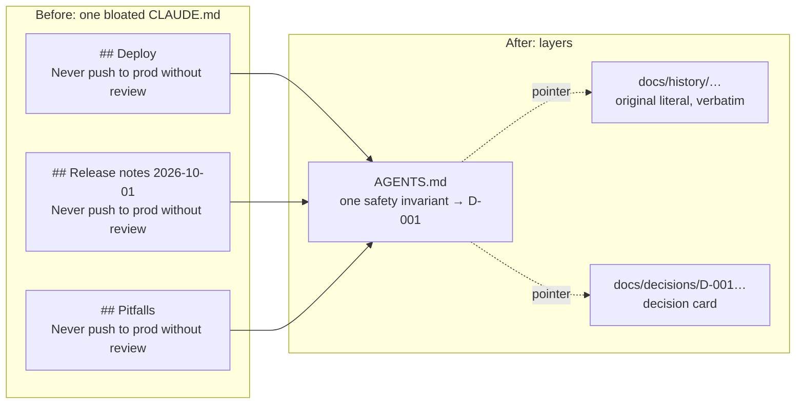

# declutter

[Español](README.es.md)

**Declutter your AI agent's context (CLAUDE.md / AGENTS.md) without losing a single rule — and prove it.**


`declutter` is a small Python command-line tool (`declutter`), a Claude Code plugin and a
documented method. It measures the context your coding agents load at start, reorganizes a
bloated `CLAUDE.md` / `AGENTS.md` into layers with a byte-level proof that nothing was lost, and
keeps it from growing back. The engine uses only the standard library, reads files, never touches
the network and never calls an AI.

> **About `<owner>`.** The public repository does not have its final home yet. Every
> `<owner>/declutter` in this README (and in the plugin) is a placeholder for the GitHub account
> that will host it; replace it with that account once the repository is published.

## Before and after

The same safety rule often ends up pasted into several sections of `CLAUDE.md`. `declutter reorg`
moves every line, verbatim, to exactly one layer; the distillation then replaces the repeated
copies by one short invariant that points to the original literal, kept in the history.



The same idea as plain text (synthetic example):

```text
BEFORE                                    AFTER
CLAUDE.md                                 AGENTS.md
├─ ## Deploy                              └─ Safety invariants (distilled)
│   - Never push to prod without review       - Never push to prod without review → D-001
├─ ## Release notes 2026-10-01            docs/history/2026-10.md
│   - Never push to prod without review       every original line, verbatim, with its anchor
└─ ## Pitfalls                            docs/decisions/D-001-….md
    - Never push to prod without review       what, why, rejected alternative, pitfall
```

## Install

Engine (Python 3.11 or newer), straight from the repository with pipx:

```bash
pipx install git+https://github.com/<owner>/declutter
declutter --version
```

The PyPI distribution will be called `declutter-context` (the name `declutter` is taken); it is
not published yet, so install from the repository. The importable package is
`declutter_context` and the command is `declutter`.

Claude Code plugin (optional; it calls the `declutter` command, so install the engine first). The
repository doubles as a marketplace named `declutter`:

```text
/plugin marketplace add <owner>/declutter
/plugin install declutter@declutter
```

Supported platforms: macOS and Linux. Windows is untested: the plugin hook uses POSIX shell
syntax (`2>/dev/null || true`), so it needs Git Bash.

## Quickstart (3 commands)

Inside a git repository with a `CLAUDE.md`:

```bash
declutter measure              # 1. traffic light: what is heavy, and why
declutter reorg plan           # 2. lossless plan + projection; prints the run id
declutter reorg apply <id>     # 3. writes on a new branch declutter/reorg-<id>, proven byte for byte
```

If the plan lists pending confirmations (units with an imperative rule that would leave layer 1),
record your decision for each one with `declutter reorg set` before applying. In Claude Code,
`/declutter:declutter` walks you through the whole process: it measures, offers
`/declutter:declutter-reorg` when there is no reorganization yet or `/declutter:declutter-auto`
when there is one, and ends by showing what was saved using only the figures the tools print.

## How it compares

Several good tools work on agent context, and they solve different problems. The table describes
categories in general terms; check each project for its current features.

| Kind of tool | Examples | What it is for | What declutter does instead |
|---|---|---|---|
| Compressors that rewrite | caveman-compress, squeez | Shorter wording of instruction or memory files to save tokens. | Does not rewrite your rules to save space: every original line lands verbatim in one layer, and the only shortened text (a distilled invariant) is checked against its literal, which stays one link away. |
| Section splitters | claudectx | Split a large context file into smaller pieces. | Splits by a 5-layer method and adds a lossless proof, safety guards, a new branch per change and a one-command undo. |
| Linters | ctxlint, instrlint | Check instruction files and report problems. | Also measures (nine signals, S1-S9), then can act on the findings and guard the result with a ratchet. |
| Synchronizers | rulesync | Keep rules in step across several agents' formats. | Does not convert formats: keeps one `AGENTS.md` that Codex reads and Claude Code imports (`@AGENTS.md`). |

What sets declutter apart:

- **Lossless.** `reorg` places every original line, verbatim, in exactly one destination.
- **Verifiable.** A byte-level proof (checks C0-C9) runs before writing, after writing and after
  the commit; `declutter reorg verify <id> --strict` runs it again at any time.
- **Deterministic.** The engine has no AI and no network: the same input gives the same plan.
- **Undone with one command.** `declutter reorg undo <id>` for a reorganization,
  `declutter reorg distill-undo <id> --card D-NNN` (or `--auto <n>`) for a distillation.
- **Ratchet.** `declutter ratchet check` fails (exit 3) when the context grows back past the
  baseline; raising a maximum is always an explicit, logged human decision.

## Safety guarantees

- **Read-only by default.** `measure`, `radar`, the hook and the status line never write inside
  your projects. `init` writes only new files and never overwrites.
- **Writes only on your decision.** `reorg` plans in `.declutter/` inside the project, applies on a
  new branch after a git tag (`declutter/pre-reorg-<id>`) and **never merges or pushes**: merging
  is always yours.
- **Safety rules stay verbatim.** Guards G1-G9 keep safety rules in `AGENTS.md`; a unit carrying
  an imperative rule leaves layer 1 only after an explicit acceptance.
- **Secrets stop everything.** A secret scan halts the run with exit code 5; files such as
  `.env`, `*.pem`, `*.key`, `id_*` or `secrets*` are never read, and symlinks cannot escape the
  project.
- **Metadata, not content.** Text and JSON output carry ids, line ranges, sizes and hashes, not
  the text of your files.
- **No network, no AI** in the engine. The plugin skills use your Claude Code session only to draft
  decision cards from their verbatim literal, and the engine checks every draft.
- **Fail-safe hook.** The `SessionStart` hook never blocks a session and always exits 0.

See [SECURITY.md](SECURITY.md).

## How to stop and how to undo

- **Stop a batch.** `declutter reorg distill-auto` announces each card and stops cleanly on Ctrl+C
  or SIGTERM (exit 130): the card in progress is either completed or cancelled without writing.
  In Claude Code, say "stop" (or press Esc) while `/declutter:declutter-auto` fills the cards, and
  nothing is applied.
- **Confirmations you cannot skip.** `reorg apply` with a guard acknowledgement, `distill-apply`
  and `ratchet relax` ask for confirmation in a terminal; `--yes` never skips them.
- **Undo a reorganization:** `declutter reorg undo <id>` restores the sources.
- **Undo a distillation:** `declutter reorg distill-undo <id> --card D-NNN` (last one first, LIFO)
  or `declutter reorg distill-undo <id> --auto <n>` for a whole automatic batch.
- **Nothing disappears while you decide.** The branch `declutter/reorg-<id>` and the tag
  `declutter/pre-reorg-<id>` stay until you delete them; `declutter reorg prune <id>` removes the
  local literal copies only when you ask.

## Commands

| Command | What it does |
|---|---|
| `declutter measure` | Computes nine signals (S1-S9) for a project and prints a traffic light with the value, the threshold, a one-line explanation and a suggested action. |
| `declutter radar` | One table for all your registered projects: traffic light, last activity, uncommitted and unpushed work, open items from each project's state file. Text, Markdown (`--md`) or JSON. |
| `declutter init` | Creates only the missing context files (`AGENTS.md`, `CLAUDE.md`, state file, decision and history indexes, `declutter.toml`) in Spanish or English. Never overwrites. |
| `declutter reorg` | Reorganizes `CLAUDE.md` (and `AGENTS.md`) into the 5 layers **without losing a byte**. Then `distill-check`, `distill-apply`, `distill-auto` and `distill-undo` replace a decision card's verbatim safety copies in `AGENTS.md` by its short invariant, with the literal one link away. Never merges or pushes. |
| `declutter ratchet` | Guard against regrowth: `declutter ratchet check` compares with the baseline `reorg` records and exits with 3 when the context grows back. |
| `declutter hook session-start` | Claude Code `SessionStart` hook: prints one line only when the project is red. |
| `declutter statusline` | Claude Code status line: context percentage plus the worst signal. |

```text
declutter measure [path] [--json] [--fail-on {yellow,red}] [--lang {es,en}]
declutter radar [--registry REGISTRY] [--md [FILE]] [--json] [--discover DIR] [--save] [--lang {es,en}]
declutter init [path] [--lang {es,en}] [--dry-run]
declutter reorg guide|plan|check|set|apply|verify|undo|status|prune [-C DIR] ...
declutter reorg distill-check|distill-apply|distill-auto|distill-undo ID [-C DIR] ...
declutter reorg codex-budget [-C DIR] [--bytes N] [--dry-run] [--lang {es,en}]
declutter ratchet check|relax|unpin|repin [-C DIR] ...
declutter hook session-start        # reads the hook JSON on stdin
declutter statusline                # reads the status line JSON on stdin
```

Exit codes: `0` ok, `1` usage error, `2` internal error, `3` threshold reached (`--fail-on`),
Codex budget over 100 % or a ratchet failure, `4` invalid plan or failed proof, `5` secret
detected. Every subcommand has `--help`. Token counts are **estimates** (`ceil(bytes / 3.6)`,
configurable) and are labelled as such.

The registry lives in `~/.config/declutter/projects.toml` (honors `XDG_CONFIG_HOME`); the cache
and the hook error log live under `~/.cache/declutter/` (honors `XDG_CACHE_HOME`).

## Claude Code plugin

| Skill | What it does |
|---|---|
| `/declutter:declutter` | Entry point: measure, then `/declutter-reorg` or `/declutter-auto`, then what was saved. |
| `/declutter:declutter-hygiene` | Explains each yellow or red signal and its action. Diagnosis only. |
| `/declutter:declutter-check` | Status table of all registered projects (`--deep` drafts missing state files, with consent). |
| `/declutter:declutter-init` | Previews and creates the missing context files after your OK. |
| `/declutter:declutter-reorg` | Drives `declutter reorg` from the plan's JSON; asks before every write, apply and commit. |
| `/declutter:declutter-distill` | Distills one decision card at a time; you run `distill-apply` yourself in a terminal. |
| `/declutter:declutter-auto` | Fills every pending card from its literal and runs `distill-auto` once. |

None of them merges, pushes or relaxes the ratchet.

## Signals

The project's traffic light is the worst of its signals. A value **greater than** the yellow
threshold is yellow, greater than the red threshold is red; signals that do not apply show `n/a`.

| Id | Signal | How it is computed | Yellow | Red |
|---|---|---|---|---|
| S1 | Root instruction lines | Lines in root `CLAUDE.md` + `AGENTS.md` | > 200 | > 400 |
| S2 | Startup tokens (Claude) | Estimated tokens of everything Claude Code loads at start, `@imports` resolved up to 4 hops | > 8 000 | > 20 000 |
| S3 | Codex budget | % of the shared budget (32 KiB, or `project_doc_max_bytes` from the project's `.codex/config.toml`) used by the `AGENTS.md` chain; yellow with no value when there is no `AGENTS.md` but `CLAUDE.md` has instructions | > 60 | > 100 |
| S4 | Changelog ratio | % of `##` headings that look like dated or per-branch log entries | > 20 | > 40 |
| S5 | Memory cap | `MEMORY.md` lines (loads first 200) and bytes (loads first 25 KB) | > 150 lines or > 18 432 B | > 190 lines or > 24 576 B |
| S6 | Compactions | Compaction markers in the most recent session transcript of the project | > 5 | > 10 |
| S7 | State freshness | Days since the state file's `Updated:` date; a missing state file (or date) is yellow | > 7 | > 21 |
| S8 | Branches and worktrees | Local branches already merged into the main branch; git worktrees | > 50 branches or > 10 worktrees | > 150 or > 20 |
| S9 | Docs without status | Handoff or plan Markdown files without a `status:`/`estado:` header | > 20 | > 100 |

Override any threshold in `declutter.toml` (project) or the global config file; `declutter init`
writes a fully commented template.

Why these signals: Claude Code's documentation recommends keeping each `CLAUDE.md` under 200
lines and loads only the first 200 lines or 25 KB of `MEMORY.md`; Codex reads the `AGENTS.md`
chain under one shared budget (32 KiB by default). Sources:
[Claude Code memory](https://code.claude.com/docs/en/memory.md) ·
[Codex AGENTS.md guide](https://developers.openai.com/codex/guides/agents-md).

## Status line

Add this to your Claude Code user settings (`~/.claude/settings.json`):

```json
{
  "statusLine": {
    "type": "command",
    "command": "declutter statusline"
  }
}
```

It prints the context-window percentage and, when the project is yellow or red, the offending
signal (for example `ctx 42% · 🔴 S1 450 lines`).

## Method and guide

The tool encodes a 5-layer convention (permanent rules, zone rules, live state, history,
decisions). The [guide](docs/guide.en.md) explains it and shows how to migrate a bloated
`CLAUDE.md` with `declutter reorg` (or by hand), how to distill the decision cards and how to use
the ratchet. Changes are listed in the [CHANGELOG](CHANGELOG.md).

## Roadmap

- `PreCompact` snapshot with re-injection after compaction.
- Real token usage read from session transcripts.
- Assisted cleanup of branches and stale documents.
- Optional MCP server.

## License

[MIT](LICENSE) © 2026 declutter contributors
